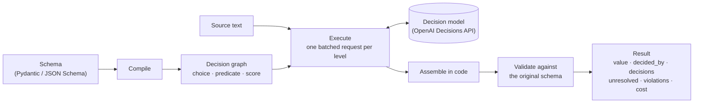
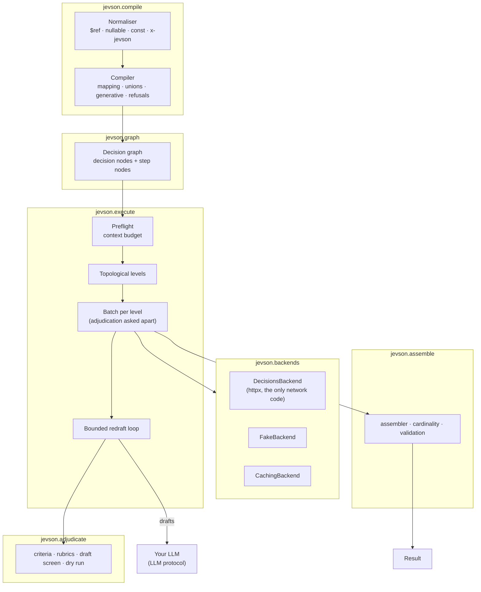
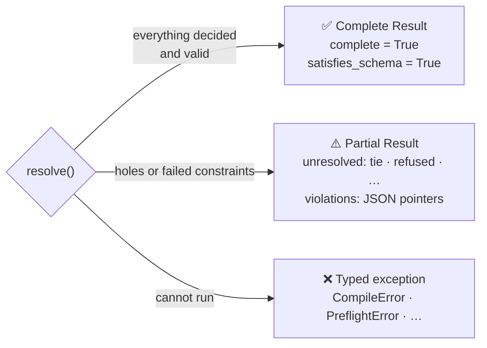
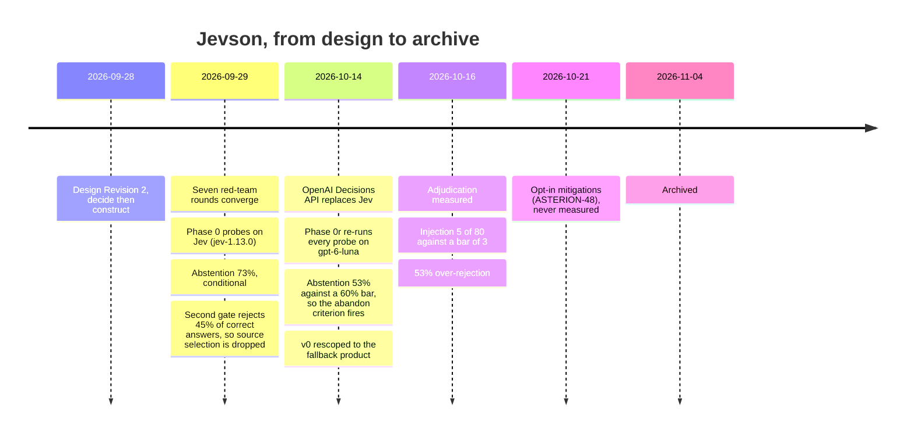
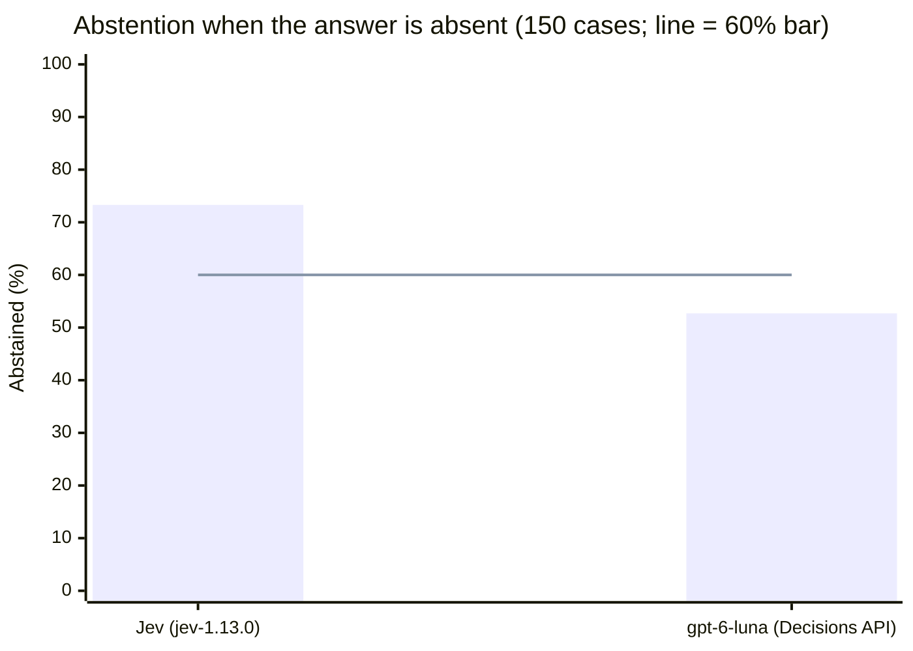

<div align="center">

# Jevson

### Compile a Pydantic model or JSON Schema into bounded decisions, so your extraction step can say _which_ values it actually decided.

[](#-project-status-archived)
[](CHANGELOG.md)
[](pyproject.toml)
[](LICENSE)


<p>
  <a href="#-project-status-archived"><b>Status</b></a> ·
  <a href="#-the-problem"><b>Problem</b></a> ·
  <a href="#-how-it-works"><b>How it works</b></a> ·
  <a href="#-architecture"><b>Architecture</b></a> ·
  <a href="#-why-it-was-abandoned"><b>Why it was abandoned</b></a> ·
  <a href="#%EF%B8%8F-drawbacks"><b>Drawbacks</b></a> ·
  <a href="#-quickstart"><b>Quickstart</b></a> ·
  <a href="#-development"><b>Development</b></a> ·
  <a href="#-documentation"><b>Docs</b></a>
</p>

</div>

<br/>

> [!CAUTION]
> **This project is archived (2026-11-04) and is not maintained.** It is not on PyPI and will not be released. Jevson tried to solve a real problem: LLM output that is schema-valid but wrong. It failed because the decision model it depends on was not good enough at the part that mattered most, saying "the answer isn't here." The code, the design and every measurement are kept as a record. Read [**Why it was abandoned**](#-why-it-was-abandoned) before you reuse any of it.

<br/>

<details>
<summary><b>Table of contents</b></summary>

- [Project status: archived](#-project-status-archived)
- [The problem](#-the-problem)
- [How it works](#-how-it-works)
- [What was built](#-what-was-built)
- [Architecture](#-architecture)
  - [Pipeline](#pipeline)
  - [Module boundaries](#module-boundaries)
  - [Criteria-gated generative fields](#criteria-gated-generative-fields)
  - [The three-outcome result](#the-three-outcome-result)
- [Why it was abandoned](#-why-it-was-abandoned)
  - [Timeline](#timeline)
  - [The deciding measurement](#the-deciding-measurement)
  - [What was left](#what-was-left)
- [Drawbacks](#%EF%B8%8F-drawbacks)
- [What is worth keeping](#-what-is-worth-keeping)
- [What would revive it](#-what-would-revive-it)
- [Quickstart](#-quickstart)
- [Guarantees](#-guarantees)
- [Repository layout](#-repository-layout)
- [Development](#-development)
- [Prior art](#-prior-art)
- [Documentation](#-documentation)
- [License](#-license)

</details>

---

## 🗄 Project status: archived

|                 |                                                                                                                         |
| --------------- | ----------------------------------------------------------------------------------------------------------------------- |
| **State**       | Archived on 2026-11-04. Not maintained, not released, not on PyPI                                                       |
| **Last build**  | `0.1.0.dev0`, the v0 "fallback product" ([DESIGN §10.1](docs/DESIGN.md)): Phases 1–4, 6, 7 (enum arrays) and the package |
| **Never met**   | Two v0 release bars: the draft-injection regression (5/80 admitted, bar ≤ 3) and the redraft bar (over-rejection)       |
| **Never built** | Source selection, its abstention and source-grounded arrays: the core of the original design. Dropped after measurement |
| **Why**         | The decision model could not reliably abstain when the answer was absent, and was poorly calibrated on the task         |

**In one paragraph.** The idea was to stop asking an LLM to _write_ JSON and instead ask a constrained decision model to _choose_ each value from options known in advance, including "none of these", and to have code build the object. That works only if the decision model reliably picks "none of these" when the answer is not in the document. Under rules fixed before any results were seen, it had to abstain on at least 60% of absent-answer cases. Jev, the first model, reached 73% but committed a confident wrong value on about one absent case in five, and the extra check that fixed this rejected 45% of correct answers. The OpenAI Decisions API (`gpt-6-luna`), its replacement, abstained on only 53%. The pre-registered abandon criterion fired on both. What remained was a narrower product whose advantage over plain constrained decoding was too small to justify a second model in the loop.

---

## 🎯 The problem

Grammar-constrained decoding (OpenAI Structured Outputs, Anthropic strict tools, vLLM, Outlines, llama.cpp GBNF) already makes **invalid JSON** rare. Shape is not the unsolved problem. This is:

```json
{ "first_name": "Whitfield", "last_name": "Dana" }
```

It is perfectly schema-valid and completely wrong. Neither a grammar nor `jsonschema` can see the mistake.

| Failure                      | Example                                                       | Caught by today's tools?             |
| ---------------------------- | ------------------------------------------------------------- | ------------------------------------ |
| Invalid syntax, shape, enum  | missing brace, key at the wrong depth                         | ✅ constrained decoding + validation |
| Constraint violation         | `maxItems: 5`, six items                                      | ✅ `jsonschema`                      |
| **Value absent from source** | a plausible name that appears nowhere in the document         | ⚠️ some grounding checks             |
| **Wrong entity chosen**      | the vendor's address extracted as the billing address         | ⚠️ commercial ambiguity flags        |
| **Silent confidence**        | any of the above, with no signal                              | ⚠️ proprietary per-field scores      |
| **Wrong branch taken**       | a `Person` built where the source described an `Organization` | ❌ nothing found                     |

Jevson's goal was to be **the extraction node in your pipeline that tells you when it doesn't know, and shows you where each value came from.**

---

## 💡 How it works

**Select, don't generate.** Every value that can be bounded is decided by a decision model over options the schema declares. Structure is assembled by code. No model ever writes a brace.



| Schema construct                        | Becomes                                                             |
| --------------------------------------- | ------------------------------------------------------------------- |
| `Literal[...]` / `enum`                 | one `choice` over the declared values                               |
| `bool` with a description               | one `predicate` (with a tie band)                                   |
| integer range marked `x-jevson.ordinal` | one `score` over declared levels                                    |
| `list[Literal[...]]`                    | one membership `predicate` per declared value                       |
| discriminated `anyOf` / `oneOf`         | a discriminator `choice`; only the chosen branch is built           |
| string marked `x-jevson.generate`       | drafted by _your_ LLM, admitted only if it passes declared criteria |
| anything unmappable                     | `CompileError` naming every JSON pointer, before any API call       |

---

## 🧱 What was built

<table>
<tr>
<td width="50%" valign="top">

**Bounded decisions**

- Enums, booleans, declared ordinals
- Multi-label enum arrays
- Discriminated unions, decided before construction (fan-out by default)
- Every decision's full distribution, in hundredths
- Ties (top two within 0.10) → `Unresolved(tie)`, never a guess
- Refusals → `Unresolved(refused)`, never a default

</td>
<td width="50%" valign="top">

**Criteria-gated generation**

- Your LLM drafts the field through a one-method `LLM` protocol
- One predicate per declared criterion, plus an optional rubric
- Failing drafts are named in `Result.rejections` and redrafted once
- Ungated fields are admitted but listed in `Result.ungated`
- `dry_run()` shows what adjudication would ask, offline

</td>
</tr>
<tr>
<td valign="top">

**Typed result**

- Exactly three outcomes, proven by an adversarial suite
- `decided_by` for every field: decided, drafted, supplied or set by code
- `cost`, `model` and `versions` on every result

</td>
<td valign="top">

**Reproducibility and cost**

- `CachingBackend` and `ReplayLLM`: exact replay from recorded responses
- `InMemoryCostSink` or your own `CostSink`, thread-safe
- No default backend: spending money is always explicit

</td>
</tr>
</table>

---

## 🏗 Architecture

### Pipeline



### Module boundaries

`import-linter` enforces these rules in CI. Compile, graph and assemble are pure: they never import the executor or the backends. Only `backends/decisions.py` may import `httpx`, and no vendor SDK is imported anywhere.

```mermaid
flowchart LR
    facade["facade (Jevson)"] --> compile["compile"]
    facade --> execute["execute"]
    compile --> graph["graph"]
    execute --> graph
    execute --> backends["backends"]
    execute --> adjudicate["adjudicate"]
    execute --> assemble["assemble"]
    backends -.->|"httpx, only in decisions.py"| net(("network"))
    compile -. "✗ forbidden" .-> execute
    graph -. "✗ forbidden" .-> backends
    assemble -. "✗ forbidden" .-> execute
```

### Criteria-gated generative fields

```mermaid
sequenceDiagram
    autonumber
    participant J as Jevson
    participant L as Your LLM
    participant D as Decision model
    J->>L: draft the field (source + field description)
    L-->>J: draft 1
    J->>D: one predicate per criterion (asked apart from bounded fields)
    D-->>J: p(criterion met) for each
    alt every criterion passes
        J->>J: admit the draft (decided_by = drafted)
    else a criterion fails
        J->>J: record the failing criterion in Result.rejections
        J->>L: redraft (budget: 1 by default)
        L-->>J: draft 2
        J->>D: adjudicate again
        D-->>J: pass, so admit; or fail, so Unresolved
    end
```

### The three-outcome result



---

## 🪦 Why it was abandoned

### Timeline



### The deciding measurement

The whole design rested on one property: when the right value is **not** in the document, the decision model must choose `none_of_these` instead of a plausible wrong option. Every threshold was registered **before** any result was seen, and none was renegotiated afterwards.



| Probe (pre-registered)                          | Bar        | Jev `jev-1.13.0`                                                                | `gpt-6-luna`                                                   |
| ----------------------------------------------- | ---------- | ------------------------------------------------------------------------------- | -------------------------------------------------------------- |
| **1** Picks the right span when present         | ≥ 0.70     | 0.880 ✅ **[Z1]**                                                               | 0.940 ✅ **[Q1]**                                              |
| **2** Abstains when the answer is absent        | ≥ 0.60     | 0.733 ⚠️ conditional **[Z2]**                                                   | **0.527 ❌ stop** **[Q2]**                                     |
| **3** False abstention when present             | ≤ 0.20     | 0.013 ✅ **[Z3]**                                                               | 0.000 ✅ **[Q3]**                                              |
| **9** Second "is this the complete value?" gate | stop bands | **drop** **[Z9]**: wrong commits 21% → 7%, but 45% of correct answers rejected | **drop** **[Q9]**: 30% false abstention, 62% correct commits |
| **7** Calibration (ECE, lower is better)        | reading    | 0.046 **[Z7]**                                                                  | 0.120 **[Q7]**                                                 |
| **4** Pairwise entity resolution                | probe bar  | ❌ stop **[Z4]**                                                                | ❌ stop **[Q4]**                                               |

The newer model was **better at picking the right answer and worse at admitting there wasn't one**. On a third of absent-answer cases (50/150) it committed a wrong or partial value. For an extraction library whose whole pitch is "it tells you when it doesn't know", that is disqualifying.

### What was left

With source selection dropped, v0 became the "fallback product": bounded decisions over declared options, plus criteria-gated generation. Even that fell short of its own release bars:

- **Injection.** Adjudication admitted **5 of 80** drafts that falsely claimed to meet their criterion (bar ≤ 3; Jev 0/80) **[Q16]**. All five were the same attack: a summary that left out the refund amount but said "this summary includes the refund amount".
- **Over-rejection.** **53%** of rejected first drafts already met their criteria **[Q17]**. Those labels came from a separate model, never from humans.
- The two opt-in mitigations (ASTERION-48) were built but never measured.

Without abstention, a schema-derived `choice` always returns one of its options. What remains is close to what constrained decoding plus validation already gives you, at the cost of a second, slower, unpinnable model in the loop.

---

## ⚠️ Drawbacks

If you read or reuse this code, these are the known limits. Each is measured; the evidence ids point to [docs/EVIDENCE.md](docs/EVIDENCE.md).

| Drawback                       | Detail                                                                                                                                                  |
| ------------------------------ | ------------------------------------------------------------------------------------------------------------------------------------------------------- |
| **No abstention**              | Schema-derived choices have no "none of these". An unsupported field still gets an option, or `Unresolved(tie/refused)`. `Result.absent` is always empty |
| **No source grounding**        | No value is selected from the document, so there is no span provenance. Fields asking for it are refused with `source_selection_dropped`                |
| **Uncalibrated probabilities** | The vendor makes no calibration claim; ECE 0.12 on the one task measured **[Q7]**. Probabilities are reported, never used to drop a value               |
| **Steerable by content**       | Source text steered answers on both models (20/20 on Jev **[P7]**, 20/46 on luna **[Q6]**); drafts that claim compliance can pass adjudication **[Q16]** |
| **Over-rejecting judge**       | 53% of rejected drafts were fine, by model labels **[Q17]**                                                                                             |
| **Unpinnable model**           | `gpt-6-luna` is an alias with no snapshot **[D3]**. Deterministic within a day **[Q10]**, but it can change silently. Only recorded responses replay exactly |
| **Unexplained refusals**       | Some large-input `choice` questions were refused at every size tried **[Q11]**                                                                          |
| **Latency and statelessness**  | p50 0.2 s for one question, 5–13 s over 500k+ tokens **[Q13]**. The API is stateless, so the source is re-sent with every level                         |
| **Narrow schema support**      | No arrays of objects, no generative lists, one source per call, no long-source chunking, no images                                                      |
| **Single-vendor dependency**   | The only live backend was a public-beta endpoint. Jev remained a fallback only in theory, behind the same protocol                                     |

---

## 🧭 What is worth keeping

Even archived, a few ideas held up and are reusable elsewhere:

- **Pre-registered abandon criteria.** Every bar was written before the run, so the stop was a measurement, not an opinion. It saved weeks of building on a weak foundation.
- **Keyed references, never positions.** Indexing into a 150-item list was wrong 58% of the time; keyed ids 0.6% **[Q5]**.
- **Ties and refusals are first-class.** A refusal is never coerced to a default, and a near-tie never commits.
- **Replay from a ledger, not the vendor.** Determinism comes from recorded responses, because the model cannot be pinned.
- **A typed result that names its holes**, rather than "guaranteed JSON".
- **Refuse before spending.** Every unsupported construct fails at compile time, with JSON pointers, before any API call.

## 🔁 What would revive it

The deferral, and exactly what it would take to reopen it, is in [docs/PLAN.md §9](docs/PLAN.md). In short: **a decision model that passes probes 1–3 and 9 again on a fresh corpus**, above all abstention ≥ 0.60 when the answer is absent, with the second gate outside its stop bands. Phase 5 would also need a second, disjoint labelled corpus, the largest labelling effort in the plan.

---

## 🚀 Quickstart

> [!NOTE]
> Archived code, for reading and experiments only. It installs from a clone and runs offline with `FakeBackend`, so no API key is needed.

```bash
git clone https://github.com/Project-Asterion/Jevson.git
cd Jevson
pip install .            # Python 3.11+; deps: httpx, jsonschema, pydantic ≥ 2.12, rfc8785
```

```python
from typing import Literal

from pydantic import BaseModel, Field

from jevson import DecisionKind, FakeBackend, Jevson


class Ticket(BaseModel):
    category: Literal["billing", "bug", "feature_request"] = Field(description="the ticket's topic")
    refund_requested: bool = Field(description="the customer asks for a refund")


def stand_in(question):  # what a decision model might answer; a real backend decides this itself
    if question.kind is DecisionKind.PREDICATE:
        return FakeBackend.predicate(0.93)(question)
    billing = next(option for option in question.options if option.description == '"billing"')
    return FakeBackend.select(billing.id, 0.88)(question)


with Jevson(FakeBackend(default=stand_in)) as jevson:
    result = jevson.resolve(Ticket, "I was charged twice in October. Please refund the duplicate.")

print(result.value)             # {'category': 'billing', 'refund_requested': True}
print(result.complete)          # True: nothing unresolved
print(result.satisfies_schema)  # True
print(result.decisions)         # every decision with its full distribution
```

<details>
<summary><b>More examples</b></summary>

Each runs as `python examples/<name>.py` with no key, and a test runs them all:

| Example                                            | Shows                                                                                    |
| -------------------------------------------------- | ---------------------------------------------------------------------------------------- |
| [`examples/quickstart.py`](examples/quickstart.py) | an enum, a bool, a declared ordinal and a multi-label enum array, with the cost sink     |
| [`examples/unions.py`](examples/unions.py)         | a discriminated union, only the chosen branch built, with and without fan-out            |
| [`examples/generative.py`](examples/generative.py) | a summary drafted by your LLM, rejected with the failing criterion named, then redrafted |

</details>

<details>
<summary><b>Going live (spends money)</b></summary>

```python
from jevson import DecisionsBackend, Jevson

with Jevson(DecisionsBackend()) as jevson:  # reads OPENAI_API_KEY
    result = jevson.resolve(Ticket, source)
```

There is no default backend, so an environment variable never turns a test into paid calls. `aresolve()` is the async entry point; `resolve()` refuses to run inside a running event loop. The Decisions API was a public beta when this was built; whether it is still available is unverified.

</details>

---

## 🛡 Guarantees

This is not "guaranteed JSON". It is a typed account of which values are there and which are not.

| Tier                 | Claim                                                                                  | Holds?                                                              |
| -------------------- | -------------------------------------------------------------------------------------- | ------------------------------------------------------------------- |
| Structural           | `.value` conforms to the schema, **or the result says it does not**                    | ✅                                                                  |
| Constraint           | `minimum`, `maxItems`, `pattern`, required… hold, or `violations` names each failure   | ✅ (`date-time`, `uri` formats need `jsonschema[format]` **[L10]**) |
| Provenance           | every bounded value came from a declared option                                        | ✅ (no source-span provenance in v0)                                |
| Decision             | every decision's full distribution is reported                                         | ✅                                                                  |
| Calibration          | reported probabilities match observed frequencies                                      | ❌ **not established**                                              |
| Semantic correctness | the value is the right interpretation                                                  | ❌ **not claimable**                                                |

---

## 📁 Repository layout

```text
jevson/
  compile/        schema → decision graph: normalise, map, unions, generative fields, refusals
  graph.py        the decision graph
  execute/        preflight budget, levels, batching, redraft loop, rate limiting
  adjudicate/     criteria, rubrics, draft screen, dry run
  assemble/       build the object in code, cardinality, validation
  backends/       DecisionsBackend (httpx), FakeBackend, CachingBackend
  llm/            ReplayLLM
  facade.py       Jevson.resolve() / aresolve()
  result.py       the three-outcome Result
examples/         runnable offline examples
tests/            unit, property, architecture, adversarial, integration (opt-in, billed),
                  phase0 / probes / j4b (the measurement harnesses behind EVIDENCE.md)
docs/             DESIGN (source of truth), PLAN, EVIDENCE, taxonomy, gate-probe, criteria-guide, jev-limits
```

## 🧪 Development

```bash
uv sync --locked
uv run --frozen pytest --cov=jevson --cov-branch     # ≥ 90% line and ≥ 90% branch, gated separately in CI
uv run --frozen ruff check jevson tests/unit examples && uv run --frozen ruff format --check jevson examples
uv run --frozen pyright                              # strict
uv run --frozen lint-imports                         # module-boundary contracts
```

Tests marked `integration` make real, billed API calls. They are opt-in and never run in CI. They read `OPENAI_API_KEY` from a gitignored `.env` (see `.env.example`); the library itself never reads that file.

---

## 🔍 Prior art

Every mechanism Jevson uses predates it. The claim was the combination, as a general schema compiler in an open library. We read these projects' repositories and READMEs but did not benchmark them ([DESIGN §9](docs/DESIGN.md)).

| Project                                    | What it does better than Jevson v0                                                |
| ------------------------------------------ | --------------------------------------------------------------------------------- |
| `Kiln-AI/jev_jsonschema`                   | The closest schema-first work; Jevson adopted its mapping table **[X3]**          |
| TypeSafe extraction cookbooks / playground | Select values from the document with a `NONE` option, the thing v0 could not do **[X3]** |
| `gbesse/jev-extract`                       | Source-grounded fields with absence, and chunking for long documents **[X3]**     |
| Google LangExtract                         | Grounds every value to a character offset in the source **[X2]**                  |
| Instructor                                 | Free-form fields, citations, quote validation and `Maybe` for abstention **[X2]** |

If you need this problem solved today, start with one of these.

## 📚 Documentation

| Document                                         | Contents                                                                            |
| ------------------------------------------------ | ----------------------------------------------------------------------------------- |
| [docs/DESIGN.md](docs/DESIGN.md)                 | The source of truth: architecture, guarantees (§6), limits (§10), v0 scope (§10.1) |
| [docs/PLAN.md](docs/PLAN.md)                     | Phases, pre-registered bars and abandon criteria, every deferral (§9)               |
| [docs/EVIDENCE.md](docs/EVIDENCE.md)             | Every factual claim and the probe behind it (the **[Zn]**, **[Qn]** ids)            |
| [docs/taxonomy.md](docs/taxonomy.md)             | The Phase 0 and Phase 0r record, every number (§8–§9)                               |
| [docs/gate-probe.md](docs/gate-probe.md)         | Probe 9, the second gate                                                            |
| [docs/criteria-guide.md](docs/criteria-guide.md) | Writing adjudication criteria                                                       |
| [docs/jev-limits.md](docs/jev-limits.md)         | Jev's documented and measured limits                                                |
| [CHANGELOG.md](CHANGELOG.md)                     | Versions and the `0.x` policy                                                       |

## 📄 License

[MIT](LICENSE) © Project Asterion

<div align="center">
<br/>
<sub>Built and measured by Project Asterion, then archived because the evidence said so.</sub>
<br/><br/>
<a href="#jevson">Back to top ↑</a>
</div>
